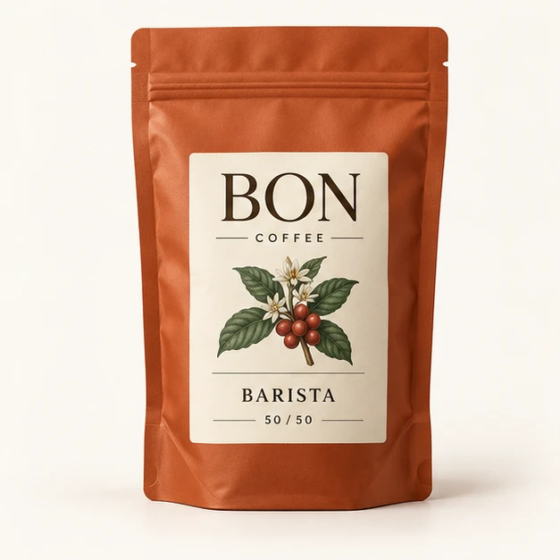
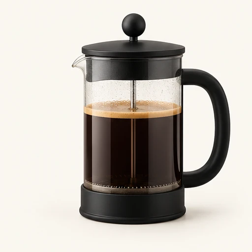
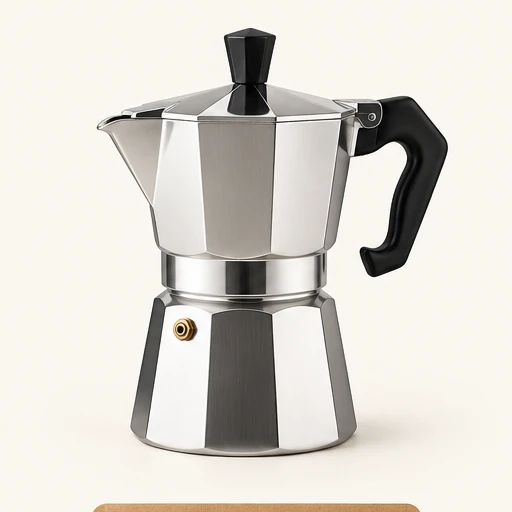

<div dir="rtl" align="right">

# بُن | فروشگاه قهوه و ابزار دم‌آوری

نمونه‌ای تمام‌صفحه و واکنش‌گرا برای یک فروشگاه قهوه؛ با فرانت‌اند فارسی و راست‌چین، و یک API مستقل با **Django REST Framework** و **PostgreSQL**.

**[مشاهدهٔ دموی آنلاین فرانت‌اند](https://bon-demo-showcase.netlify.app/)**

> **وضعیت انتشار:** سایت Netlify فقط فرانت‌اند ایستا را میزبانی می‌کند. بک‌اند Django و پایگاه دادهٔ PostgreSQL این پروژه در حال حاضر محلی هستند و به‌صورت عمومی مستقر نشده‌اند. قابلیت‌های وابسته به API را با اجرای محلی پروژه آزمایش کنید.

## پیش‌نمایش

<p align="center">
  <a href="assets/coffee-hero.mp4">
    
  </a>
  <br>
  <a href="assets/coffee-hero.mp4">▶ تماشای ویدیوی معرفی فروشگاه</a>
</p>

تصاویر واقعی محصولات موجود در پروژه:

<p align="center">
  
  
  
  
</p>

## امکانات

### فروشگاه و فرانت‌اند

- رابط کاربری فارسی و راست‌چین، واکنش‌گرا و مبتنی بر HTML، CSS و JavaScript خالص
- صفحهٔ اصلی فروشگاه، دسته‌بندی‌ها، جست‌وجو و مسیرهای نمایش محصولات
- تصاویر محصولات، بنر ویدیویی و انیمیشن‌های موجود در طراحی
- فهرست ایستای محصولات برای پیش‌نمایش فروشگاه

### API و بک‌اند

- API کاتالوگ برای دسته‌بندی‌ها، فهرست محصولات و جزئیات هر محصول
- ثبت‌نام، ورود، خروج و پروفایل با احراز هویت نشست Django و محافظت CSRF
- علاقه‌مندی‌ها و سبد خرید ماندگار برای کاربران، همراه با کنترل تعداد
- ثبت سفارش در پایگاه داده با محاسبهٔ سمت سرور برای قیمت، ارسال و کد تخفیف
- تاریخچه و جزئیات سفارش و پیگیری با کد سفارش
- پرداخت **کاملاً شبیه‌سازی‌شده**؛ هیچ درگاه بانکی یا تراکنش واقعی وجود ندارد
- پنل مدیریت Django و مستندات OpenAPI / Swagger

## فناوری‌ها

| بخش | فناوری |
| --- | --- |
| بک‌اند | Python 3.11، Django 5.2، Django REST Framework |
| پایگاه داده | PostgreSQL؛ برای توسعهٔ محلی می‌توان از SQLite استفاده کرد |
| مستندات API | drf-spectacular، OpenAPI و Swagger UI |
| ارتباط فرانت‌اند و API | JavaScript خالص، نشست Django، کوکی و CSRF |
| اجرا و CI | Docker Compose و GitHub Actions |

## ساختار پروژه

```text
.
├── assets/                 تصاویر، فونت و ویدیوی پیش‌نمایش
├── backend/
│   ├── catalog/            دسته‌بندی‌ها و محصولات
│   ├── shop/               کاربران، علاقه‌مندی، سبد و سفارش
│   └── config/              تنظیمات و مسیرهای Django
├── .github/workflows/ci.yml
├── app.js
├── integration.js
├── index.html
├── products.js
├── styles.css
├── Dockerfile
└── compose.yaml
```

## اجرای محلی

پیش‌نیازها: Python 3.11 یا جدیدتر و Node.js برای بررسی syntax جاوااسکریپت. برای اجرای PostgreSQL از Docker اختیاری است.

۱. وابستگی‌های بک‌اند را نصب کنید:

```powershell
cd backend
python -m venv .venv
.\.venv\Scripts\Activate.ps1
pip install -r requirements.txt
```

۲. فایل نمونهٔ تنظیمات را کپی کنید و فقط تنظیمات محلی را وارد کنید:

```powershell
Copy-Item .env.example .env
```

در `backend/.env` یک `DJANGO_SECRET_KEY` خصوصی تنظیم کنید. برای اجرای امن روی SQLite محلی، `SQLITE_NAME=local.sqlite3` بگذارید و تمام متغیرهای `DB_NAME`، `DB_USER`، `DB_PASSWORD`، `DB_HOST` و `DB_PORT` را خالی نگه دارید. بدین ترتیب مهاجرت‌های توسعه به PostgreSQL محلی شما وصل نمی‌شوند. فایل `.env` محرمانه است و نباید commit شود.

۳. با فعال‌بودن محیط مجازی و همچنان از پوشهٔ `backend`، دیتابیس SQLite محلی را آماده و API را اجرا کنید:

```powershell
python manage.py migrate
python manage.py runserver 127.0.0.1:8000
```

۴. در یک ترمینال دیگر، از پوشهٔ اصلی پروژه فرانت‌اند را سرو کنید:

```powershell
python -m http.server 5500
```

سپس [http://127.0.0.1:5500](http://127.0.0.1:5500) را باز کنید. فرانت‌اند محلی API را به‌طور پیش‌فرض از `http://127.0.0.1:8000` فراخوانی می‌کند. برای بارگذاری کاتالوگ ایستا در دیتابیس محلی، از دستور `python manage.py seed_catalog --if-empty` استفاده کنید.

برای سرویس جداگانهٔ فرانت‌اند و بک‌اند، `window.BON_API_BASE_URL` را پیش از بارگذاری `app.js` روی مبدأ API تنظیم کنید. در محیط‌های HTTPS، دامنه‌های دقیق را در `CORS_ALLOWED_ORIGINS` و `CSRF_TRUSTED_ORIGINS` بگذارید و کوکی‌های امن و تنظیمات مناسب نشست cross-site را فعال کنید.

## Docker Compose

از پوشهٔ اصلی پروژه اجرا کنید:

```powershell
docker compose up --build
```

Compose سرویس PostgreSQL و Django را با volume پایدار بالا می‌آورد؛ سرویس وب پس از سلامت دیتابیس، migrationها و بارگذاری اولیهٔ کاتالوگ را اجرا می‌کند. PostgreSQL به پورت میزبان منتشر نمی‌شود تا با PostgreSQL محلی تداخل نداشته باشد. مقادیر پیش‌فرض Compose صرفاً برای توسعهٔ محلی‌اند؛ برای استقرار واقعی از مقادیر محرمانه و سرور مناسب production استفاده کنید. سرور همراه Dockerfile، سرور توسعهٔ Django است و برای production در نظر گرفته نشده است.

## API و مستندات

پس از اجرای بک‌اند محلی:

- طرح OpenAPI: [http://127.0.0.1:8000/api/schema/](http://127.0.0.1:8000/api/schema/)
- رابط Swagger: [http://127.0.0.1:8000/api/docs/](http://127.0.0.1:8000/api/docs/)
- احراز هویت: `/api/auth/csrf/`، `/api/auth/register/`، `/api/auth/login/`، `/api/auth/logout/`، `/api/auth/profile/`
- کاتالوگ: `/api/categories/`، `/api/products/`
- کاربر و سفارش: `/api/favorites/`، `/api/cart/`، `/api/orders/`، `/api/orders/create/`، `/api/payments/simulated/`

## آزمون و یکپارچه‌سازی پیوسته

در پوشهٔ `backend`:

```powershell
python manage.py check
python manage.py makemigrations --check --dry-run
python manage.py test
```

دستور معمول `manage.py test` تنظیمات ایزوله را انتخاب می‌کند، بارگذاری `.env` را غیرفعال می‌کند و از SQLite حافظه‌ای برای دیتابیس آزمون استفاده می‌کند. فایل `.env` یا دیتابیس PostgreSQL محلی برای اجرای این آزمون‌ها لازم نیست. از `--settings=config.settings` برای آزمون استفاده نکنید، مگر آنکه دیتابیس هدف را خودتان کاملاً ایزوله کرده باشید.

از ریشهٔ پروژه، بررسی‌های فرانت‌اند و Compose:

```powershell
node --check app.js
node --check integration.js
docker compose config --quiet
```

GitHub Actions از Python 3.11 و سرویس PostgreSQL مجزا استفاده می‌کند و بررسی Django، سازگاری migrationها، migration دیتابیس CI، تست‌های بک‌اند و syntax جاوااسکریپت را اجرا می‌کند.

## نکات مهم و محدودیت‌ها

- دموی عمومی Netlify فقط فرانت‌اند را نمایش می‌دهد و به بک‌اند عمومی متصل نیست؛ قابلیت‌های وابسته به API در آن فعال نیستند.
- قیمت‌ها، موجودی و اطلاعات فروشگاه نمایشی‌اند؛ فروش واقعی انجام نمی‌شود.
- پرداخت فقط برای نمایش جریان سفارش شبیه‌سازی شده است؛ اطلاعات بانکی وارد نکنید.
- بک‌اند، دیتابیس production، درگاه پرداخت واقعی و فرایند استقرار production در این پروژه منتشر نشده‌اند.
- برای اتصال آیندهٔ فرانت‌اند Netlify به یک بک‌اند، ابتدا بک‌اند را جداگانه و امن مستقر و HTTPS، CORS، CSRF، میزبان‌ها و کوکی‌ها را پیکربندی کنید.

---

ساخته‌شده برای نمایش تجربهٔ طراحی فروشگاه فارسی و یکپارچه‌سازی فرانت‌اند با API جنگو.

</div>
