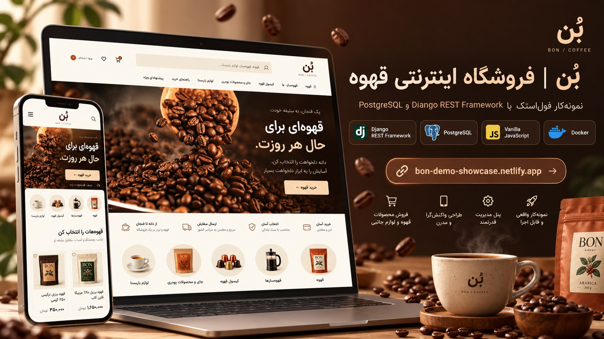
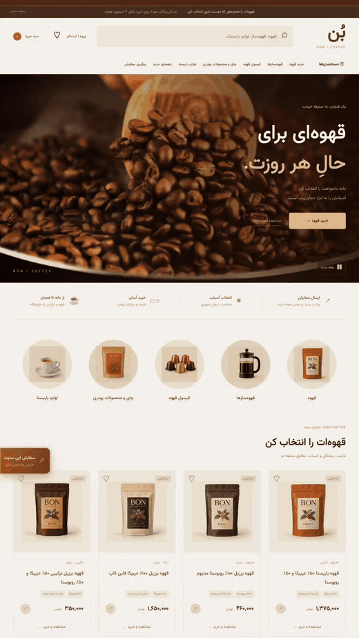
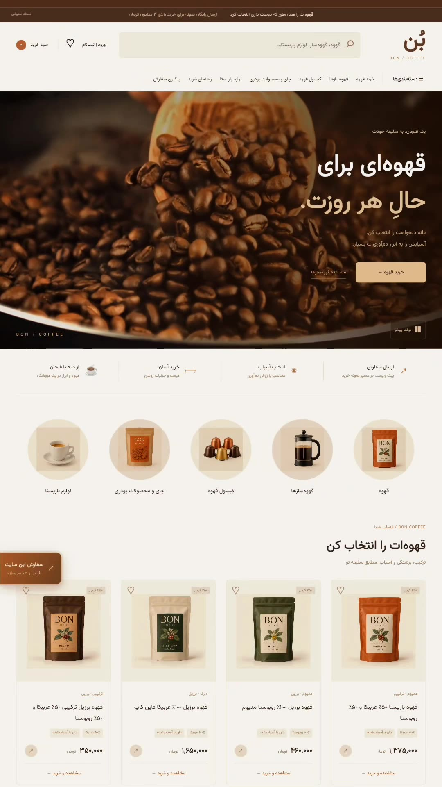
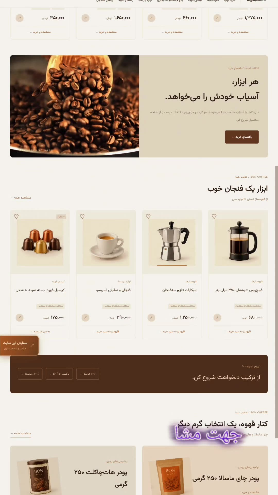
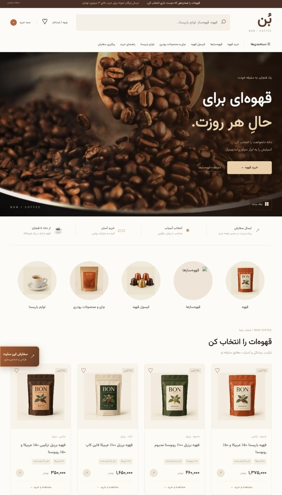
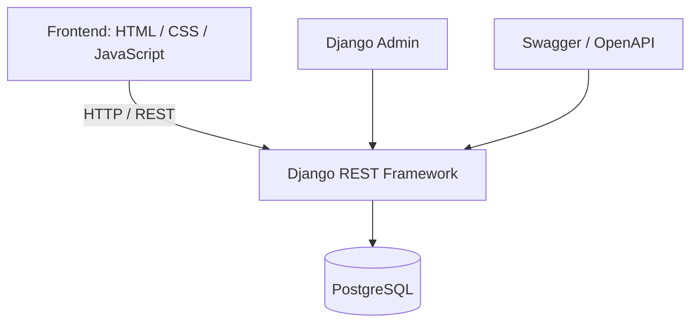
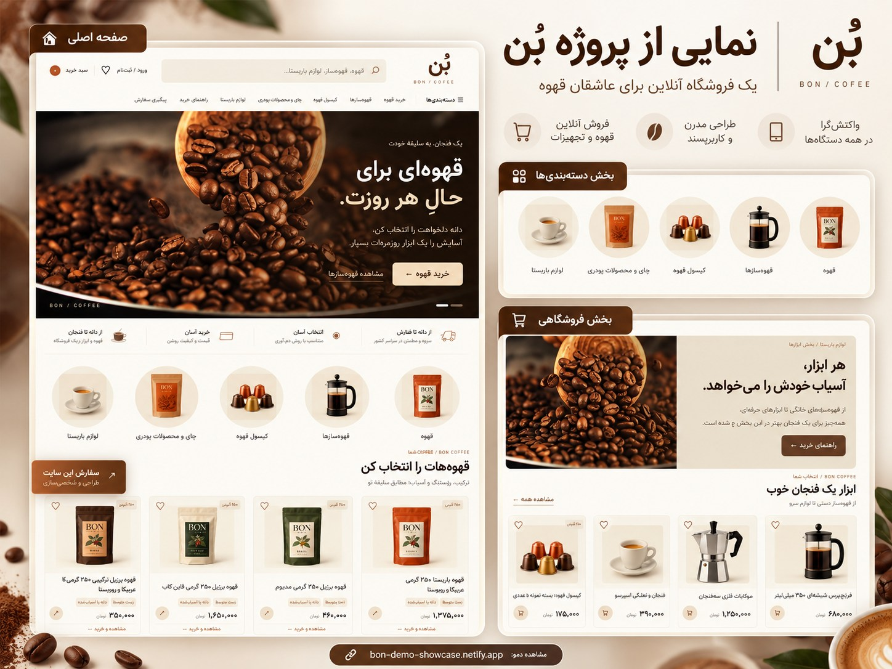

<p align="center">
  
</p>

<h1 align="center">☕ بُن | فروشگاه اینترنتی قهوه</h1>

<p align="center">
  تجربه‌ای مدرن از خرید قهوه، همراه با بک‌اند اختصاصی و APIهای قابل توسعه
</p>

<p align="center">
  
  
  
  
  
</p>

<p align="center">
  <a href="https://bon-demo-showcase.netlify.app/">🌐 مشاهده دموی سایت</a>
  &nbsp;·&nbsp;
  <a href="assets/portfolio/bon-original-walkthrough-optimized.mp4">🎬 ویدیوی معرفی</a>
  &nbsp;·&nbsp;
  <a href="assets/portfolio/bon-project-showcase.jpg">🖼️ پوستر پروژه</a>
</p>

<div dir="rtl">

> **توجه:** لینک Netlify در حال حاضر دموی عمومی **فرانت‌اند** است. بک‌اند Django و پایگاه داده هنوز به‌صورت عمومی منتشر نشده‌اند؛ بنابراین قابلیت‌های نیازمند API آنلاین در این نسخه قابل تضمین نیستند. پرداخت در پروژه صرفاً **آزمایشی** است و هیچ تراکنش بانکی واقعی انجام نمی‌شود.

## ✨ درباره پروژه

**بُن** نمونه‌کاری از یک فروشگاه اینترنتی فارسی برای قهوه و لوازم دم‌آوری است. تمرکز پروژه بر ترکیب یک رابط کاربری زیبا و واکنش‌گرا با بک‌اند ساختاریافته با **Django REST Framework** و **PostgreSQL** است.

این مخزن برای نمایش مهارت‌های توسعه بک‌اند، طراحی REST API، مدل‌سازی پایگاه داده، اعتبارسنجی، کنترل دسترسی کاربران و مدیریت جریان سفارش ساخته شده است.

## 🎞️ پیش‌نمایش متحرک واقعی

تصویر زیر از **ویدیوی واقعی سایت** استخراج شده؛ با انتخاب آن، نسخه ویدیویی معرفی باز می‌شود.

</div>

<p align="center">
  <a href="assets/portfolio/bon-original-walkthrough-optimized.mp4">
    
  </a>
</p>

<div dir="rtl">

## 📸 تصاویر واقعی سایت

تصاویر زیر از فیلم و اسکرین‌شات خود سایت تهیه شده‌اند و با پوسترهای تبلیغاتی بازطراحی‌شده تفاوت دارند.

</div>

<table>
  <tr>
    <td width="50%" align="center"></td>
    <td width="50%" align="center"></td>
  </tr>
  <tr>
    <td align="center"><strong>صفحه اصلی و محصولات</strong></td>
    <td align="center"><strong>بخش تجهیزات و محصولات</strong></td>
  </tr>
</table>

<p align="center">
  
</p>

<div dir="rtl">

## 🧩 امکانات پیاده‌سازی‌شده

- **کاتالوگ محصولات:** دریافت محصولات و دسته‌بندی‌ها، جستجو و فیلتر از طریق API.
- **حساب کاربران:** ثبت‌نام، ورود، خروج و پروفایل با احراز هویت مبتنی بر نشست (Session).
- **علاقه‌مندی‌ها:** ذخیره و مدیریت محصولات انتخاب‌شده برای هر کاربر.
- **سبد خرید:** افزودن و حذف کالا، تغییر تعداد و محاسبه مبلغ سمت سرور.
- **سفارش‌ها:** ثبت سفارش، مشاهده سوابق و پیگیری وضعیت با کنترل دسترسی.
- **پرداخت نمایشی:** شبیه‌سازی مرحله پرداخت، بدون درگاه یا انتقال وجه واقعی.
- **پنل مدیریت:** مدیریت محصولات و سفارش‌ها از طریق Django Admin.
- **مستندات API:** رابط Swagger / OpenAPI برای بررسی endpointها.

## 🛠️ فناوری‌ها

| بخش | فناوری |
| --- | --- |
| بک‌اند | Python 3.11، Django 5.2، Django REST Framework |
| پایگاه داده | PostgreSQL |
| فرانت‌اند | HTML، CSS و Vanilla JavaScript |
| مستندسازی | drf-spectacular و OpenAPI |
| کانتینرسازی | Docker و Docker Compose |
| تست خودکار | Django Test Framework و GitHub Actions |
| رابط کاربری | فارسی، راست‌به‌چپ و واکنش‌گرا |

## 🏗️ معماری کلی

</div>



<div dir="rtl">

## 🚀 راه‌اندازی محلی

برای اجرای پروژه، Python و PostgreSQL و دسترسی به تنظیمات محیطی مناسب لازم است. فایل `backend/.env.example` الگوی متغیرهای لازم است و نباید رمز عبور واقعی را وارد Git کرد.

</div>

```bash
# Install dependencies in an active Python virtual environment
pip install -r backend/requirements.txt

cd backend
python manage.py migrate
python manage.py seed_catalog
python manage.py runserver
```

<div dir="rtl">

سپس API از نشانی `http://127.0.0.1:8000/` در دسترس خواهد بود. برای جلوگیری از مشکلات Cookie و CSRF، فرانت‌اند را نیز با سرور HTTP محلی و تنظیمات Origin صحیح اجرا کنید؛ بازکردن فایل HTML با `file://` برای آزمایش کامل احراز هویت توصیه نمی‌شود.

### اجرای Docker

در صورت نصب و اجرای Docker Desktop / Docker Engine، ابتدا مقادیر لازم را مطابق تنظیمات `compose.yaml` مشخص کنید و سپس:

</div>

```bash
docker compose up --build
```

<div dir="rtl">

> **وضعیت Docker:** ساختار Compose بررسی شده، ولی طبق آخرین گزارش توسعه، اجرای کامل کانتینرها با Docker Engine هنوز تأیید نشده است.

## 📖 مستندات و تست‌ها

با اجرای بک‌اند به‌صورت محلی:

- **Swagger UI:** `http://127.0.0.1:8000/api/docs/`
- **OpenAPI Schema:** `http://127.0.0.1:8000/api/schema/`

</div>

```bash
cd backend
python manage.py check
python manage.py test
```

<div dir="rtl">

در بررسی‌های فعلی، **۱۱ تست Django** موفق بوده‌اند و اجرای GitHub Actions روی مخزن عمومی نیز موفق گزارش شده است. وضعیت هر اجرای جدید باید در تب Actions بررسی شود.

## 🖼️ پوستر معرفی

پوسترهای گرافیکی برای معرفی پروژه بازطراحی شده‌اند؛ **نمایش واقعی صفحات سایت** در تصاویر و ویدیوی بالا قابل بررسی است.

</div>

<p align="center">
  
</p>

<div dir="rtl">

---

**☕ بُن — تلفیق طراحی چشم‌نواز و مهندسی بک‌اند.**

[مشاهده دموی فرانت‌اند](https://bon-demo-showcase.netlify.app/)

</div>
